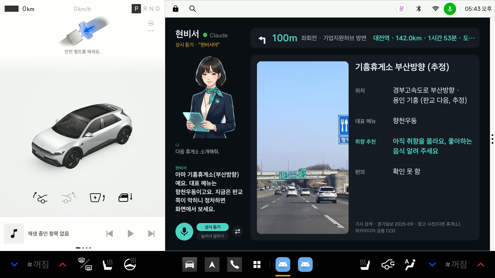
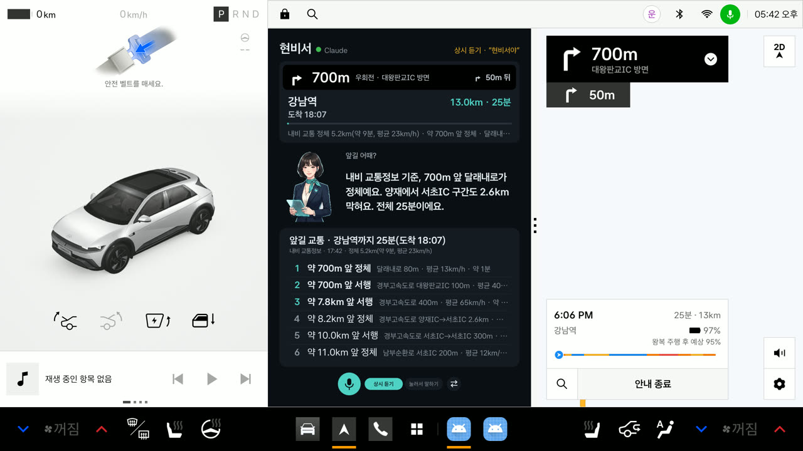
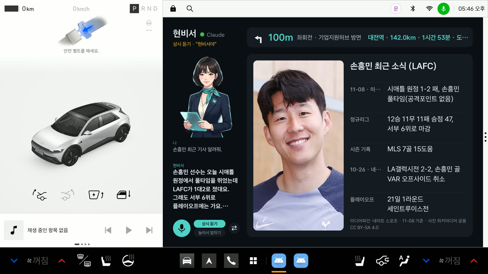
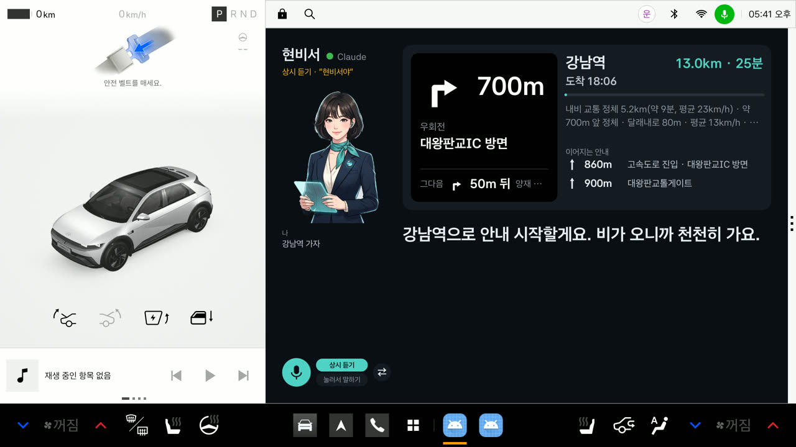
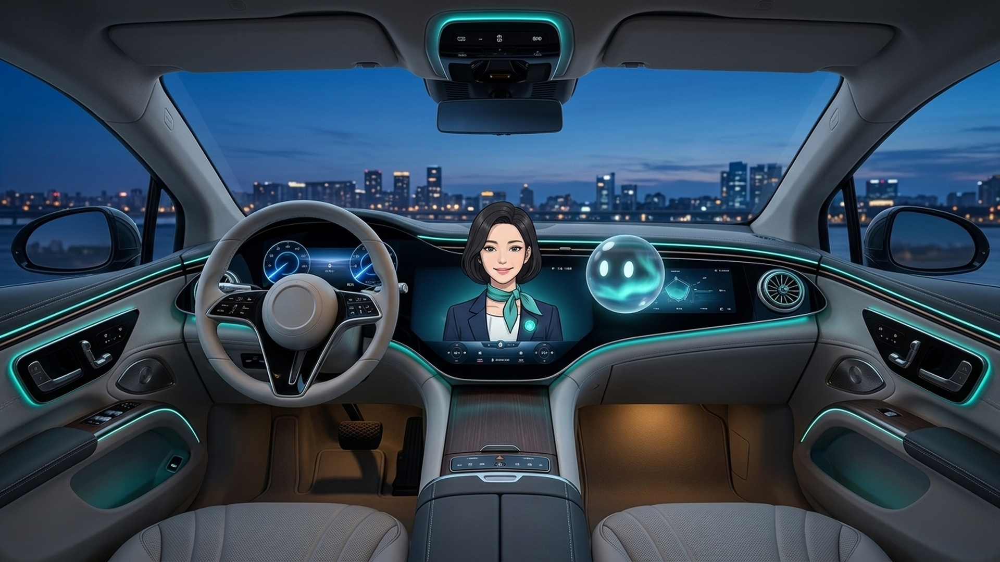
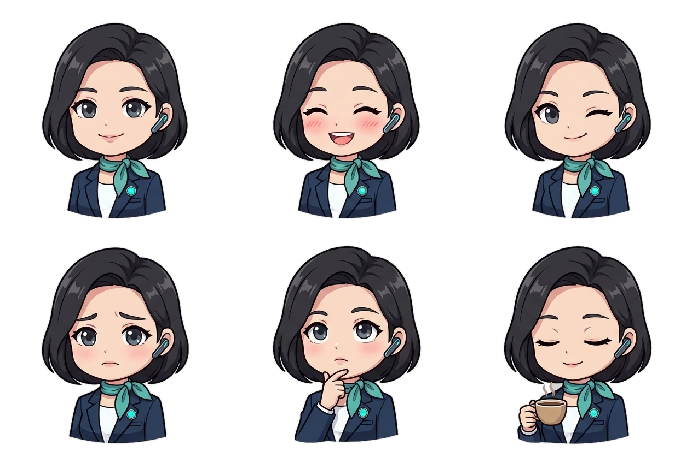

# 현비서 — 조수석 대화 비서

현대자동차그룹 차량용 앱 개발 공모전(2026) 출품작 「현비서」의 앱·서버·시험 코드입니다. Pleos Connect(AAOS 기반 인포테인먼트)에서 돌고, 운전자와 말로 대화하며 취향을 배우고, 내비 교통을 정찰해 먼저 알려 줍니다.

> **이 저장소가 앱·서버·시험 코드의 정본입니다**(2026-11-09~ · 공모전 심사용 공개 2026-11-14). 팀은 브랜치(`feat/<모듈>`)·PR로 작업합니다 — 규칙·명령·담당은 [`CLAUDE.md`](CLAUDE.md). `docs/*.md`(`docs/specs/` 빼고)는 작업 저장소(makecar-hy) 설계 문서의 사본입니다.

## 심사용 제출 정보 (2026 현대자동차그룹 차량용 앱 개발 공모전)

| 항목 | 내용 |
|---|---|
| 앱 이름 · 한 줄 소개 | **현비서** — 몇 명이 탔는지, 무엇을 좋아하는지 알고 먼저 말을 거는 조수석 대화 비서 (팀 **현비서팀**) |
| APK | **[`apk/현비서팀_현비서_release.apk`](apk/현비서팀_현비서_release.apk)** — 차 앱(release · 서명됨, 심사 대상) · 함께 쓰는 폰 앱 [`apk/현비서팀_현비서폰_release.apk`](apk/현비서팀_현비서폰_release.apk)(선택 — 차에서 물어본 것이 폰으로 이어짐) · 같은 파일 [GitHub Release `nash-20261114`](https://github.com/somanghao/hyunbiseo/releases/tag/nash-20261114) |
| 개발 · 테스트 에뮬레이터 | **Pleos Connect Emulator v2.1.0** — AVD `Pleos_Connect_v2.1` · 시스템 이미지 `android-34/pleos_car_emulator/x86_64`(Android 14 · AAOS) |
| 화면 규격 | **2560 × 1440 가로 · 160 dpi(mdpi)** — 앱은 내비와 나란히(반반)와 앱 전체 화면 둘 다 지원 |
| 테스트 환경 | Windows 11 · JDK 21(빌드할 때) · Python 3(서버 — 3.14에서 확인) · Claude Code 로그인(두뇌) · faster-whisper(받아 적기 — GPU 있으면 large-v3) |
| 접수양식 · 영상 · 소개 자료 | [`docs/submission/`](docs/submission/) — 접수양식(기획서) docx · 구현 영상 · 소개 자료 PPTX · PDF |

### 실행 방법

1. **에뮬 켜기 + PC 마이크 연결**
   ```bash
   emulator -avd Pleos_Connect_v2.1 -no-snapshot -no-boot-anim -gpu host
   adb -s emulator-5554 emu avd hostmicon
   ```
2. **PC 서버 켜기**(두뇌 · 받아 적기 — 앱은 에뮬 안에서 `http://10.0.2.2:8790`으로 붙는다)
   ```bash
   claude                                                    # 처음 한 번 — 이 PC에서 Claude Code 로그인(두뇌가 이 계정으로 답한다)
   python -I -X utf8 -u server/hyun/hyun_server.py           # 두뇌 · 정보 통로 :8790
   <faster-whisper venv>/python -I -X utf8 -u server/hyun/stt_server.py   # 받아 적기 :8791
   ```
3. **APK 설치 · 실행**
   ```bash
   adb -s emulator-5554 install -r -g apk/현비서팀_현비서_release.apk
   adb -s emulator-5554 shell am start --user 10 -n io.github.somanghao.makecar.hyun/.HyunActivity
   ```
4. **"현비서야" 하고 말 걸기** — 예: "천안아산역 가자" · "오늘 뉴스 들려줘" · "앞길 어때?". 주행 상황(기어 D · 속도)은 Pleos Virtual Console로 바꾼다.

- 대화 · 검색 · 취향은 PC 서버(위 2)가 떠 있어야 동작한다.
- 폰 앱(선택): 안드로이드 폰 에뮬에 `adb install -r -g apk/현비서팀_현비서폰_release.apk` → `adb reverse tcp:8790 tcp:8790` → `adb shell am start -n io.github.somanghao.makecar.hyunphone/.MainActivity --es server http://10.0.2.2:8790`
- release 빌드는 시험용 방송 수신기(디버그 전용)가 꺼져 있다 — 자동 시험(`tools/hyun_e2e`)은 아래 '실행'의 디버그 빌드로.



| 반반 화면(내비와 나란히) · 교통 표 | 인물 기사 — 사진 · 기사 표 |
|---|---|
|  |  |
| **내비 판** — 캐릭터 오른쪽에 다음 회전 · 남은 거리 | **도착 추천** — 내리면 목적지 근처 식당(카카오 로컬 실시간) |
|  |  |

## 시험 영상 · 기록

- **시연 영상** [`records/hyun-e2e/20261108-1740/video.mp4`](records/hyun-e2e/20261108-1740/video.mp4) — 12분 37초 · 케이스마다 **흰 설명 슬라이드(상황 · 물을 말) → 실제 에뮬레이터 화면** · **자막 = 실제 대화**(운전자 · 현비서 · 화면 카드 · 주행 이벤트) · **소리** = 에뮬레이터 소리(현비서 목소리 · 내비 안내) + 운전자 시험 목소리(Windows 한국어 합성 — 앱 귀에 넣은 그 소리)
- **보고서** `records/hyun-e2e/20261108-1740/report.html`(내려받아 브라우저로 — 영상 장면 이동 · 케이스별 판정 · 대화 · 스크린샷) · 전체 기록 `transcript.json`
- 시나리오 정본 [`tools/hyun_e2e/cases.json`](tools/hyun_e2e/cases.json) — 13개, 최종 실행 **13/13 통과**(2026-11-08)

| 케이스 | 내용 | 응답(말 → 답) |
|---|---|---|
| e00 | 시동 — 인사 · "브리핑 뭐부터 들을까요?" → 순서 저장 | 7.3초 |
| e01 | 네비 모드 — "현비서야 강남역 가자" → 경로 · 내비 앱이 덮어도 현비서 화면 지키기 · 내비 판(회전 · 남은 거리) · 반반 화면 | 5.5초 |
| e02 | 교통상황 — "앞길 어때?" → 내비 기준 정체 표 | 5.3초 |
| e03 | 휴게소 소개 — 대전역 길 + "다음 휴게소 소개해 줘" → 사진 · 표 | 5.2 · 13.1초(검색) |
| e04 | 취향 질문 — 묻고 · 대답을 취향으로 기록 | 5.7 · 5.5초 |
| e05 · e06 | 웹툰 순위(표지 격자) · 영화 순위(목록) | 6.7 · 6.2초 |
| e07 · e08 | 야구 소식 · 손흥민 기사(웹 검색 · 사진 카드) | 13.1초 |
| e09 | 주행 중 — 300m 앞 사고(앱이 먼저 경고 · 갈림길이 남았을 때만 우회를 물음) · 휴게소 알림(말로만) | — |
| e10 | 글레오 Gleo Interface — 현비서 상황(영어) | — |
| e17 | 도착 추천 — 점심 무렵 곧 도착 → "국밥 어때요? 바로 거기로 갈까요?" → "아니 내려서 볼게" → 도착하면 근처 5곳 카드 | 5.4 · 5.2초 |
| e18 | 도착 추천 — 곧 도착 제안에 "응 거기로 가자" → 그 식당으로 길 바꿈 | 5.3초 |

## 지금 되는 것

- **말로 대화** — 상시 귀("현비서야" + Whisper, 다른 화면에서도 · 못 알아들으면 한 번 다시 묻기) · 두뇌 = 사용자 본인 Claude 계정(`claude -p`, 약 5초 · 최신 사실은 웹 검색) · 말하기 스케줄러(안전 P0 > 주행 P1 > 제안 P2 > 수다 P3, 회전 앞 침묵)
- **길** — 말로 목적지 · 경유지 넣기/빼기 · 안내 끝 · 목적지 없이 출발하면 묻기 · 출발 때 교통 요약
- **경로 정찰** — 내비 교통(사고·정체·주의 구간)을 상황별 주기로 읽어 새 위험만 · 가까운 사고는 앱이 먼저 경고 · 우회는 '우회 가능한 마지막 갈림길 전'에만 묻고, 바꿨는데 시간이 안 줄면 원래 길로
- **취향** — 칸 10 누적(좋아함·싫어함·횟수) · 오래 안 나온 취향은 약하게 · 서버 정리 봇이 중간중간 대화를 다시 읽어 다듬음
- **브리핑 · 정보 통로** — 시동 브리핑 순서 저장 · 날씨 · 뉴스 · 주식 · 환율 · 영화 · 웹툰 · 웹소설(키 없음)
- **도착 추천** — 식사 시간에 곧 도착하면 취향 맞춤 식당 하나를 먼저 제안("응"이면 그리로 길 바꿈), 내리면 근처 3~5곳 카드(카카오 로컬 실시간 · 서버에 저장 안 함)
- **화면 두 가지 · 스킨** — 대화형(큰 캐릭터 + 만화 말풍선) ↔ 정보형(정보가 메인 + 캐릭터 칸 말풍선) · 스킨 = 데이터 그대로 두고 배치·모양·글꼴만 바꾸는 JSON 한 파일(기본 · 내쉬 웹툰, 만드는 법 `android/hyun/src/main/assets/skins/README.md`) · 반반은 늘 [내비 | 현비서](내비가 덮거나 가려진 채 말하면 자동) · 구조 요약 `CLAUDE.md`
- **화면** — 차 가로 2단 · 내비 판(캐릭터 오른쪽 정보창에 다음 회전 · 남은 거리) · 현비서 화면 지키기(내비 명령 뒤 내비 앱이 덮어도 다시 앞으로) · 반반 화면(내비와 나란히 = 네비 모드) · 목록 카드 · 표지 격자 · 소개 카드(왼쪽 사진 · 오른쪽 표, 사진 = 위키미디어 공용) · 캐릭터 3종
- **Gleo Interface** — `ASK_HYUN` · `HYUN_STATUS` · `HYUN_QUIET` · 폰판 「짭비서」(대중교통·산책·업무중)

## 캐릭터 · 이미지 에셋



| 사람 비서(기본) | 빛 구슬 — 표정 | SD 비서 · 앱 아이콘 |
|---|---|---|
|  |  | <br>   |

[`design_assets/hyun/`](design_assets/hyun/) — 파일별 규격·용도는 [`README.md`](design_assets/hyun/README.md)

| 폴더 | 내용 |
|---|---|
| `human/` | 사람 비서 — 포트레이트 · 전신 시안 2안 · 턴어라운드 4뷰 · 포즈 6 · SD 표정 6 · 위젯 |
| `faces_dark/` · `faces_light/` | 빛 구슬 표정 12(어두운 유리 · 파스텔) |
| `drive/` | 주행용 간소판(256 · 128) |
| `layers/` | 레이어 분리(몸 · 오로라 · 하이라이트 · 눈 · 입 — 코드 애니메이션용) |
| `accessories/` · `shop/` · `svg/` | 꾸미기 액세서리 6(3D · 착용 예시 · 벡터) · 상점 썸네일 |
| `icons/` · 맨 위 | 앱 아이콘(적응형 · 통짜 · 카카오 128) · 스플래시 · 위젯 · 히어로 1920×1080 |
| `sheets/` | 원본 마스터 시트(잘라 내기 전 — 히어로 · 구슬 · 사람 비서) |

앱에 실제로 들어가는 캐릭터는 `android/hyun/src/main/assets/chars/`(구슬 8 · 사람 비서 12)입니다.

## 구조

```
android/hyun/…/hyun/ 앱(Kotlin) — 코어 + 기능 플러그인
  HyunActivity         껍데기(화면 · 생명주기)
  core/                Hyun(대화 엔진 — 듣기 · 말하기 · 두뇌 · 1초 루프) · Feature(기능 훅) · Fmt
  feature/             Registry(기능 목록) · Route(목적지 · 경유지) · Scout(경로 정찰 · 휴게소) · Gleo · Car(날씨 · 배터리 · 장시간) · Command(조용히 · 듣기 모드 · 캐릭터) · Phone(짭비서)
  voice/ drive/ brain/ ui/ phone/   귀 · 입 · 말하기 스케줄러 / 내비 · 정찰 판정 · 남은 거리 · 눈 · 홈 창 배치(HomeWindow) / 서버 HTTP / 화면 / 폰 전용
  ui/                  ScreenData(데이터 — 화면은 읽기만) · HyunView(배치 — 대화형·정보형·반반) · skin/(Skin = JSON 스킨 · Kit = 판·말풍선·배경)
server/hyun/         중계 서버(8790) — hyun_server.py(진입) · persona.md(캐릭터 · 말하기 규칙) · stt_server(Whisper, 8791)
  core/                설정(HYUN_DATA) · 저장 · inbox(말 ↔ 답) · HTTP · 자동 두뇌 워커
  brain/               prompt(규칙 · 답 형식 · 질문을 기능에서 모음) · cli(내 Claude 계정) · api(API 키)
  features/            route · traffic · cards · memory · taste · history · briefing · feeds(정보 통로 7) · search · restarea · phone · taste_refine(정리 봇) · login · testaudio
tools/hyun_e2e/      E2E 시험(시나리오 → 에뮬 · 녹화 · 판정 · 보고서)  ·  tools/hyun_harness/ 질문 하네스
records/hyun-e2e/    시험 기록
design_assets/hyun/  이미지 에셋 전부(아래 §캐릭터 · 이미지 에셋)
docs/                설계·실측 문서(작업 저장소 위키 사본 — [[이름]] 링크는 원본 위키 기준)
docs/specs/          모듈 6 기능 명세 + 화면 구성도(정본 — 새 기능은 여기부터)
.claude/             팀 공유 Claude Code 설정 — rules(경로별 규칙) · skills(new-feature · run-hyun) · agents(hyun-harness) · settings.json
```

## 실행(Windows · Pleos Connect Emulator v2.1)

```bash
# 에뮬 — AVD Pleos_Connect_v2.1 · PC 마이크 연결
emulator -avd Pleos_Connect_v2.1 -no-snapshot -no-boot-anim -gpu host -scale 0.5
adb -s emulator-5554 emu avd hostmicon
# 서버 — 켜면 이 PC에 로그인된 사용자 본인 Claude 계정(Claude Code)이 자동으로 답한다
python -I -X utf8 -u server/hyun/hyun_server.py
<faster-whisper venv>/python -I -X utf8 -u server/hyun/stt_server.py
# 앱 — JDK 21
cd android && ./gradlew :hyun:assembleDebug
adb -s emulator-5554 install -r -g hyun/build/outputs/apk/debug/hyun-debug.apk
adb -s emulator-5554 shell am start --user 10 -n io.github.somanghao.makecar.hyun/.HyunActivity
# 시험 — 서버를 시험 데이터로 새로 띄우고 녹화(서버는 꺼 둔 채로)
python -I -X utf8 tools/hyun_e2e/run.py --servers --video
```

- **새 기능 붙이기** = 앱 `feature/<X>Feature.kt` + `Registry` 한 줄 · 서버 `features/<x>.py` + `features/__init__.py` `ALL` 한 줄 · `tools/hyun_e2e/cases.json`에 시험 케이스 → `docs/hyun-architecture.md`
- 시연 인텐트(마이크 없이 말 · 목적지 · 정찰 주입 등)는 `core/Hyun.kt` `onIntent` 주석(코어)과 각 `feature/*.kt` 맨 위 주석(기능)
- 상용화 두뇌(현대 클라우드 PC + 사용자 본인 Claude 로그인)는 Anthropic 서면 승인이 필요합니다 — `docs/hyun-brain.md` §약관
