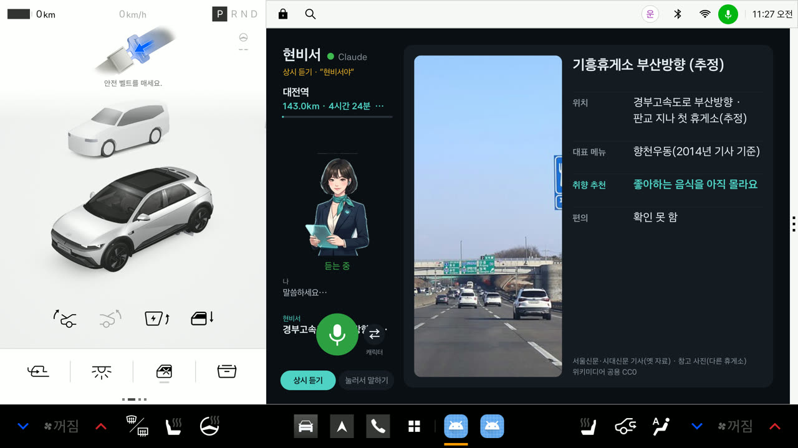
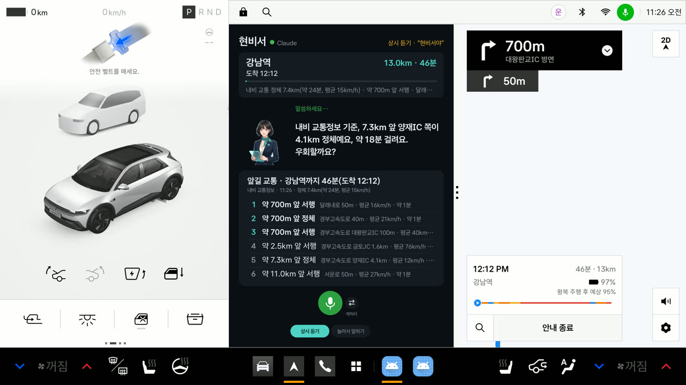
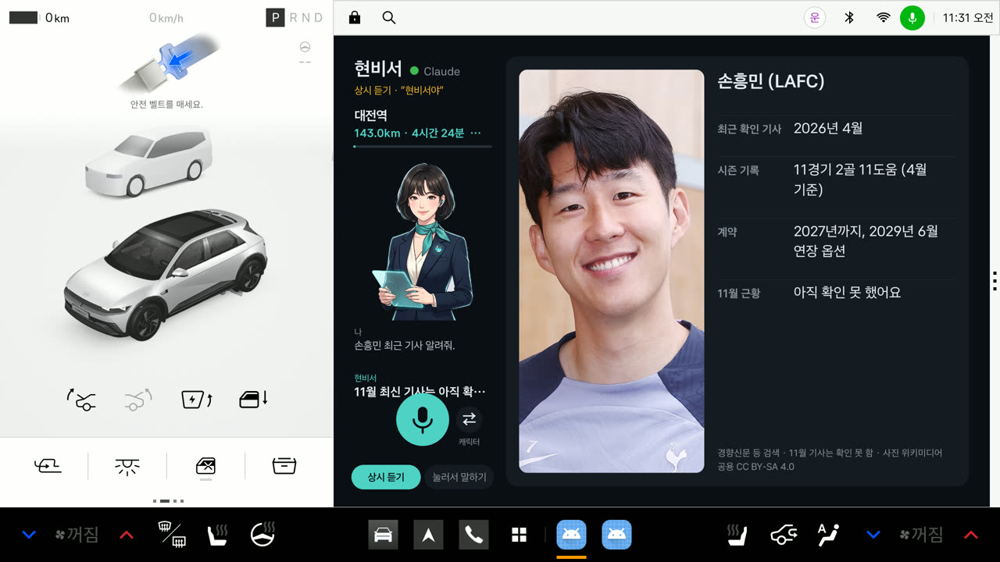

# 현비서 — 조수석 대화 비서

현대자동차그룹 차량용 앱 개발 공모전(2026) 출품작 「현비서」의 앱·서버·시험 코드입니다. Pleos Connect(AAOS 기반 인포테인먼트)에서 돌고, 운전자와 말로 대화하며 취향을 배우고, 내비 교통을 정찰해 먼저 알려 줍니다.

> 이 저장소는 작업 저장소에서 `tools/export_hyunbiseo.py`로 떼어 낸 **사본**입니다(private). 고칠 땐 원본에서 고치고 다시 내보냅니다.



| 반반 화면(내비와 나란히) · 교통 표 | 인물 기사 — 사진 · 기사 표 |
|---|---|
|  |  |

## 시험 영상 · 기록

- **영상** [`records/hyun-e2e/20261107-1125/video.mp4`](records/hyun-e2e/20261107-1125/video.mp4) — 7분 · 에뮬레이터 화면 녹화 + **자막 = 실제 대화**(운전자 · 현비서 · 화면 카드 · 주행 이벤트). 소리는 없습니다
- **보고서** `records/hyun-e2e/20261107-1125/report.html`(내려받아 브라우저로 — 영상 장면 이동 · 케이스별 판정 · 대화 · 스크린샷) · 전체 기록 `transcript.json`
- 시나리오 정본 [`tools/hyun_e2e/cases.json`](tools/hyun_e2e/cases.json) — 11개, 최종 실행 **11/11 통과**

| 케이스 | 내용 | 응답(말 → 답) |
|---|---|---|
| e00 | 시동 — 인사 · "브리핑 뭐부터 들을까요?" → 순서 저장 | 5.1초 |
| e01 | 네비 모드 — "현비서야 강남역 가자"(음성) → 경로 · 반반 화면 | 5.3초 |
| e02 | 교통상황 — "앞길 어때?" → 내비 기준 정체 표 | 5.2초 |
| e03 | 휴게소 소개 — 대전역 길 + "다음 휴게소 소개해 줘" → 사진 · 표 | 5.4 · 13.1초(검색) |
| e04 | 취향 질문 — 묻고 · 대답을 취향으로 기록 | 5.2 · 11.4초 |
| e05 · e06 | 웹툰 순위(표지 격자) · 영화 순위(목록) | 5.7 · 5.8초 |
| e07 · e08 | 야구 소식 · 손흥민 기사(웹 검색 · 사진 카드) | 13.0초 |
| e09 | 주행 중 — 300m 앞 사고(앱이 먼저 경고, 갈림길 없음 → 우회 안 물음) · 휴게소 알림 | — |
| e10 | 글레오 Gleo Interface — 현비서 상황(영어) | — |

## 지금 되는 것

- **말로 대화** — 상시 귀("현비서야" + Whisper, 다른 화면에서도 · 못 알아들으면 한 번 다시 묻기) · 두뇌 = 사용자 본인 Claude 계정(`claude -p`, 약 5초 · 최신 사실은 웹 검색) · 말하기 스케줄러(안전 P0 > 주행 P1 > 제안 P2 > 수다 P3, 회전 앞 침묵)
- **길** — 말로 목적지 · 경유지 넣기/빼기 · 안내 끝 · 목적지 없이 출발하면 묻기 · 출발 때 교통 요약
- **경로 정찰** — 내비 교통(사고·정체·주의 구간)을 상황별 주기로 읽어 새 위험만 · 가까운 사고는 앱이 먼저 경고 · 우회는 '우회 가능한 마지막 갈림길 전'에만 묻고, 바꿨는데 시간이 안 줄면 원래 길로
- **취향** — 칸 10 누적(좋아함·싫어함·횟수) · 오래 안 나온 취향은 약하게 · 서버 정리 봇이 중간중간 대화를 다시 읽어 다듬음
- **브리핑 · 정보 통로** — 시동 브리핑 순서 저장 · 날씨 · 뉴스 · 주식 · 환율 · 영화 · 웹툰 · 웹소설(키 없음)
- **화면** — 차 가로 2단 · 반반 화면(내비와 나란히 = 네비 모드) · 목록 카드 · 표지 격자 · 소개 카드(왼쪽 사진 · 오른쪽 표, 사진 = 위키미디어 공용) · 캐릭터 3종
- **Gleo Interface** — `ASK_HYUN` · `HYUN_STATUS` · `HYUN_QUIET` · 폰판 「짭비서」(대중교통·산책·업무중)

## 구조

```
android/hyun/…/hyun/ 앱(Kotlin) — 코어 + 기능 플러그인
  HyunActivity         껍데기(화면 · 생명주기)
  core/                Hyun(대화 엔진 — 듣기 · 말하기 · 두뇌 · 1초 루프) · Feature(기능 훅) · Fmt
  feature/             Registry(기능 목록) · Route(목적지 · 경유지) · Scout(경로 정찰 · 휴게소) · Gleo · Car(날씨 · 배터리 · 장시간) · Command(조용히 · 듣기 모드 · 캐릭터) · Phone(짭비서)
  voice/ drive/ brain/ ui/ phone/   귀 · 입 · 말하기 스케줄러 / 내비 · 정찰 판정 · 남은 거리 · 눈 / 서버 HTTP / 화면 · 카드 · 캐릭터 / 폰 전용
server/hyun/         중계 서버(8790) — hyun_server.py(진입) · persona.md(캐릭터 · 말하기 규칙) · stt_server(Whisper, 8791)
  core/                설정(HYUN_DATA) · 저장 · inbox(말 ↔ 답) · HTTP · 자동 두뇌 워커
  brain/               prompt(규칙 · 답 형식 · 질문을 기능에서 모음) · cli(내 Claude 계정) · api(API 키)
  features/            route · traffic · cards · memory · taste · history · briefing · feeds(정보 통로 7) · search · restarea · phone · taste_refine(정리 봇) · login · testaudio
tools/hyun_e2e/      E2E 시험(시나리오 → 에뮬 · 녹화 · 판정 · 보고서)  ·  tools/hyun_harness/ 질문 하네스
records/hyun-e2e/    시험 기록
docs/                설계·실측 문서(작업 저장소 위키 사본 — [[이름]] 링크는 원본 위키 기준)
```

## 실행(Windows · Pleos Connect Emulator v2.1)

```bash
# 에뮬 — AVD Pleos_Connect_v2.1 · PC 마이크 연결
emulator -avd Pleos_Connect_v2.1 -no-snapshot -no-boot-anim -gpu host -scale 0.5
adb -s emulator-5554 emu avd hostmicon
# 서버 — 켜면 이 PC에 로그인된 사용자 본인 Claude 계정(Claude Code)이 자동으로 답한다
python -I -X utf8 -u server/hyun/hyun_server.py
<faster-whisper venv>/python -I -X utf8 -u server/hyun/stt_server.py
# 앱 — JDK 21
cd android && ./gradlew :hyun:assembleDebug
adb -s emulator-5554 install -r -g hyun/build/outputs/apk/debug/hyun-debug.apk
adb -s emulator-5554 shell am start --user 10 -n io.github.somanghao.makecar.hyun/.HyunActivity
# 시험 — 서버를 시험 데이터로 새로 띄우고 녹화(서버는 꺼 둔 채로)
python -I -X utf8 tools/hyun_e2e/run.py --servers --video
```

- **새 기능 붙이기** = 앱 `feature/<X>Feature.kt` + `Registry` 한 줄 · 서버 `features/<x>.py` + `features/__init__.py` `ALL` 한 줄 · `tools/hyun_e2e/cases.json`에 시험 케이스 → `docs/hyun-architecture.md`
- 시연 인텐트(마이크 없이 말 · 목적지 · 정찰 주입 등)는 `core/Hyun.kt` `onIntent` 주석(코어)과 각 `feature/*.kt` 맨 위 주석(기능)
- 상용화 두뇌(현대 클라우드 PC + 사용자 본인 Claude 로그인)는 Anthropic 서면 승인이 필요합니다 — `docs/hyun-brain.md` §약관
